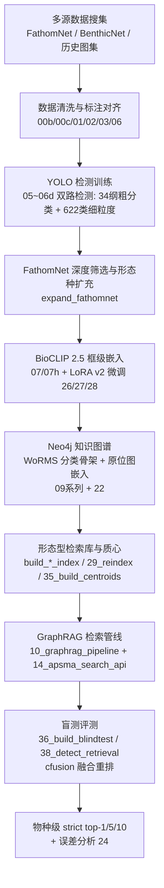

# Ocean-DePTH-VLM — 深海底栖生物细粒度识别（检索链路）

Ocean-DePTH-VLM 是一套面向深海原位图像的底栖生物细粒度识别系统。本仓库发布其中的**检索链路**部分：数据准备 → 目标检测 → 框级嵌入 → 知识图谱 → 向量检索 → 盲测评测。

核心思路：以 **WoRMS 世界海洋物种登记册**分类体系为骨架构建 Neo4j 知识图谱，图谱节点挂接海量参考图框切图嵌入（BioCLIP 2.5）；查询时 YOLO 检出生物框 → BioCLIP 嵌入 → 图谱多视图向量检索 + 形态型（morphospecies）质心融合重排（cfusion）→ 输出细粒度物种级检索结果。

> 本仓库**不含** VLM 终判/大模型部署部分（后续另行发布）。

## Pipeline



## 目录结构

```
Ocean-DePTH-VLM-Deploy-New/
├── scripts/                 # 全流程脚本（38 个编号脚本 + 1 个打包脚本，按编号分阶段）
│   ├── 00b~03, 06_parse     # 数据下载/清洗/YOLO格式转换/图集标注对齐
│   ├── expand_fathomnet.py  # FathomNet 深度筛选与形态种扩充（检索库框图来源）
│   ├── 05~06d               # YOLO 检测训练（粗分类/细粒度/类别均衡）
│   ├── 07, 07h              # BioCLIP 2.5 嵌入提取（07 为共享嵌入模块，09 号构建图谱时动态加载）
│   ├── 09~09f, 22           # 知识图谱构建（WoRMS 导入/图谱构建/重建/谱系回填/知识注入）
│   ├── build_*_index.py 等  # 形态种主索引链（物种名索引→北太/海山图集合并→形态种聚合）
│   ├── 10, 11c2             # GraphRAG 检索管线与端到端推理
│   ├── 14, 24               # 检索 API 与误差深度分析
│   ├── 26~28                # BioCLIP 2.5 视觉塔 LoRA + ArcFace 微调
│   ├── 29, 34~38            # 重索引/终评/质心/盲测集构建/闭卷与盲测评测
│   ├── package_class_yolo.sh # 34 纲数据集并行分片打包（跨服务器转移）
│   ├── setup/               # 部署冒烟测试（verify_install.py）
│   └── utils/               # 共享工具（BioCLIP 2.5 封装、双路推理、PDF 解析、数据整理等）
├── utils/                   # 预留（当前共享工具位于 scripts/utils/）
├── config/                  # Neo4j 连接、YOLO 训练、GraphRAG 推理配置
├── docs/                    # 部署与构建方法文档
├── deploy/                  # 一键部署（Docker Compose / 资产下载脚本 / 部署指南）
├── data/                    # 数据与产物（不入库，运行时生成）
└── requirements.txt
```

## 快速开始

### 1. 环境依赖

```bash
pip install -r requirements.txt
```

需要：Python 3.10+、CUDA GPU（单卡 A40 级别即可跑通推理与评测）、Neo4j 5.x（Docker: `neo4j:5.20.0`，开放 bolt://localhost:7687）。

### 2. 构建知识库与图谱

```bash
# (1) 数据准备：下载 FathomNet / 过滤 BenthicNet / 转 YOLO 格式（见脚本头部注释）
python scripts/01_download_fathomnet.py
python scripts/02_filter_benthicnet.py
python scripts/03_convert_to_yolo.py

# (2) 图集标注对齐 + APSMA 解析 → 形态型知识条目 JSONL
python scripts/00b_collect_historical_annotations.py
python scripts/00c_align_annotations_to_apsma.py
python scripts/06_parse_apsma.py

# (3) BioCLIP 2.5 嵌入提取（支持分片并行与断点续跑）
python scripts/07h_extract_bioclip25_embeddings.py --shard 0 --num-shards 1

# (4) Neo4j 图谱：WoRMS 分类骨架导入 → 知识图谱构建 → 谱系回填
python scripts/09b_import_worms_taxonomy.py
python scripts/09_build_knowledge_graph.py --neo4j-password $NEO4J_PASSWORD
python scripts/09c_rebuild_kg_bioclip25.py
python scripts/09f_backfill_lineage.py

# (5) 知识条目注入图谱
python scripts/22_inject_knowledge_to_graph.py
```

### 3. 构建向量检索索引与质心

```bash
# 形态型主索引与检索索引
python scripts/build_morphospecies_index.py
python scripts/29_reindex.py

# 从 Neo4j EntryImage 嵌入构建形态型质心矩阵（cfusion 融合用）
# 产出: centroids_v2.npz  { C: (n_mid,1024) f32 L2归一化, mids }
python scripts/35_build_centroids.py
```

### 4. 盲测评测

```bash
# (1) 构建盲测集：将抽中源图的全部框从检索库物理移除，消除"命中同源图"的开卷效应
#     产出: blindtest/manifest.json (+ removed_backup.npz, 可 --restore 恢复)
python scripts/36_build_blindtest.py

# (2) 检测+粗类别+精细检索 盲测基准（无 VLM，纯检索链路）
#     YOLO双路检测 → tight裁剪 → BioCLIP 2.5 LoRA v2 嵌入+TTA → 向量索引 top-10
#     → mid聚合 + cfusion(0.5*图像相似 + 0.5*质心相似) → 物种/属级 strict top-1/5/10
python scripts/38_blindtest_detect_retrieval.py

# (3) 闭卷对照与误差分析
python scripts/37_closedbook_eval.py
python scripts/24_deep_error_analysis.py
```

## 权重与产物（外置，不入库）

以下大文件由脚本产出或需自行准备，**均不入 Git 仓库**（见 `.gitignore`）：

| 资源 | 产出/获取方式 | 产出路径 |
|---|---|---|
| BioCLIP 2.5 基座 | 公开基座 **BioCLIP 2.5 (ViT-H/14)**：HuggingFace `imageomics/bioclip-2.5-vith14`（1,024 维；首次运行自动下载，支持 `HF_HUB_OFFLINE=1` 离线） | HF 缓存目录 |
| BioCLIP 2.5 LoRA v2 适配器 | `scripts/27_finetune_lora.py` 微调产物（视觉塔 attn/c_fc/c_proj LoRA rank=32/alpha=64 + ArcFace 头；配 `26_finetune_dataprep.py` 备数据、`28_ft_verify.py` 校验） | `<exp>/lora_adapter_v2/` + `ft_head.pt` |
| YOLO 检测权重（34 纲双路） | `scripts/05d_train_yolo_class.py` / `05c_train_yolo_finegrained.py` 训练产出 | `runs/detect/<run>/weights/best.pt` |
| 框级嵌入分片 | `scripts/07h_extract_bioclip25_embeddings.py` | `data/processed/bioclip25_embeddings/emb_shard{i}.npz` |
| 形态型质心矩阵 | `scripts/35_build_centroids.py` | `centroids_v2.npz` |
| 盲测集清单 | `scripts/36_build_blindtest.py` | `data/experiments/blindtest/manifest.json` |
| 形态型主索引 | `scripts/build_morphospecies_index.py` 等 | `data/processed/atlas_lookup/morphospecies_index.json` |

## 评测基准摘要

在 FathomNet Val 构建的**盲测集**（1,744 个查询场景；查询源图全部框已从检索库物理移除，无同源图泄漏）上的端到端结果（YOLO 双路检测 → BioCLIP 2.5 LoRA v2 嵌入 → 向量检索 + cfusion 融合重排，`CF_W=0.5`）：

| 评测 | 指标 | R5 (cfusion) |
|---|---|---|
| 物种级 strict top-1 | 38_blindtest_detect_retrieval | **49.6** |
| 物种级 strict top-5 | 同上 | **68.9** |
| 物种级 strict top-10 | 同上 | **72.6** |

## 配置

- `config/neo4j_connection.yaml` / `config/graphrag_inference.yaml`：Neo4j 连接信息。**密码请替换为你自己的值**（占位符 `YOUR_NEO4J_PASSWORD`，建议通过环境变量注入，勿提交真实密码）。
- `config/yolo_training*.yaml` / `config/yolo_finegrained.yaml`：YOLO 训练超参。
- 部分脚本默认路径指向内部数据盘，使用时请改为本地路径。

## 文档

- `docs/01_yolo_detection.md` — **第一部分 YOLO 检测**：数据集格式 / 用自己数据训练 / 替换官方权重 / 双路推理（960+TTA ∪ 1920）详解
- `docs/深海生物知识图谱构建进展汇报.md` — 数据集搜集整理与知识图谱构建方法
- `docs/西太平洋图集整理与OCR纠错流程总结.md` — 历史图集 OCR 数据整理流程
- `docs/检索v2部署指南.md` — 检索链路部署指引
- `docs/opc52_integration_plan.md` — WoRMS 数据整合计划

## License

仅供科研用途，数据使用请遵循 FathomNet / BenthicNet / WoRMS 原始许可协议。
